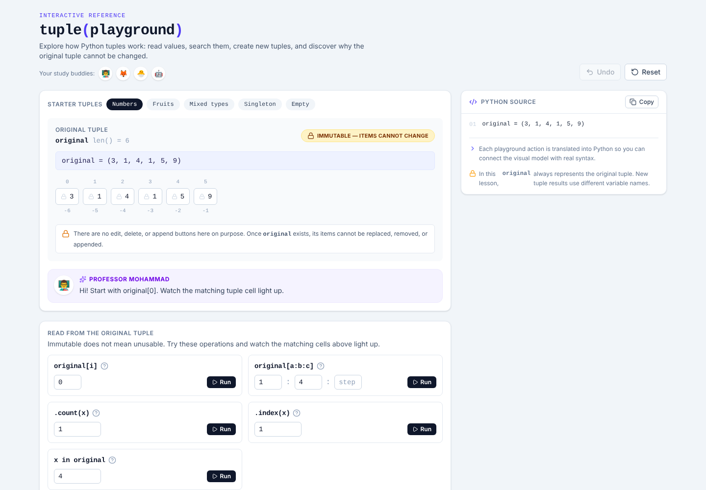

# tuple(playground)

**An interactive, click-through lesson on Python tuples, built for my MSBA classmates.**

**[▶ Open the playground](https://melisgurbuz8.github.io/python-tuple-playground/)**: runs in the browser, nothing to install.



## Why I built it

During the Python bootcamp at the start of our MSBA program, my professor built an interactive website to teach **lists**. You could click through operations and watch the list change. It worked well, but the bootcamp moved on to **tuples** without a tool like that, and tuples are where a lot of us got confused: they look almost the same as lists, but they behave differently.

So I built the tuples version myself and shared it with my classmates. It follows the same idea as the lists site: learn by trying things, and see every action as real Python code.

## What you can do

- **Pick a starter tuple:** numbers, fruits, mixed types, a single-item tuple `('hello',)` or an empty tuple `()`.
- **Read from it** and watch the matching cells light up: indexing `t[i]` (with positive and negative indexes shown), slicing `t[a:b:c]`, `.count(x)`, `.index(x)` and `x in t`.
- **Try to change it, and see it fail on purpose.** `t[i] = x` raises the same `TypeError: 'tuple' object does not support item assignment` that Python does. There are no edit, delete or append buttons, by design.
- **Make new tuples instead:** concatenation `t + other` and repetition `t * n` create a new tuple and leave the original untouched.
- **See the Python behind every click.** A live *Python source* panel writes out each step as code you can copy into a notebook, and a console shows the output, including Python-style errors such as `IndexError: tuple index out of range`.
- **Study buddies.** A professor and three characters (Mimi, Dot and Byte) give hints and explain what just happened, in plain language.
- **Undo and reset** at any point, so it's safe to experiment.

## How it works

The app is a small Python value model written in JavaScript. It mimics how Python parses and prints values (`True`, `None`, `'strings'`, the trailing comma in `(x,)`), and it follows Python's rules for indexing and slicing, including negative indexes, negative steps and the errors Python raises. That way, what you see in the playground matches what you'd get in Python.

**Built with:** React 19, Vite, Tailwind CSS and lucide icons. It's deployed to GitHub Pages with GitHub Actions on every push to `main`.

## Run it locally

Requires Node.js 20.19+ or 22.12+.

```bash
npm install
npm run dev       # opens a local dev server
npm run build     # production build in dist/
```

## About

Made by [Melis Gurbuz](https://github.com/melisgurbuz8) during the Boston University MSBA Python bootcamp, inspired by my professor's lists playground.
